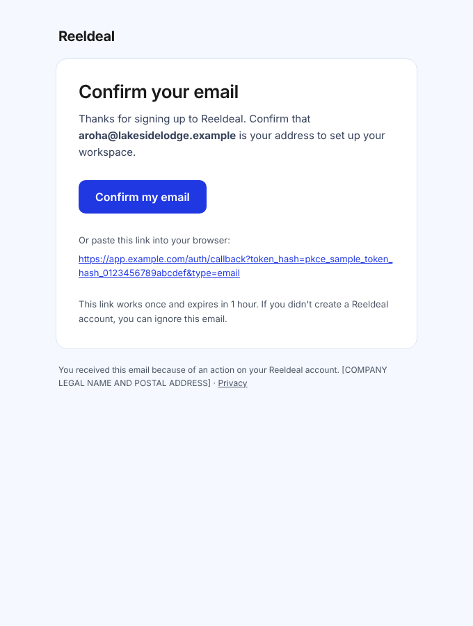
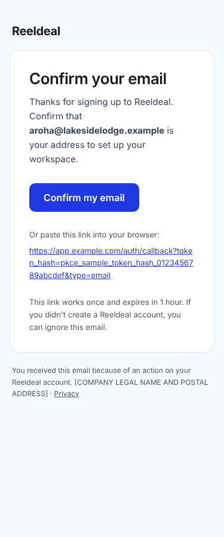
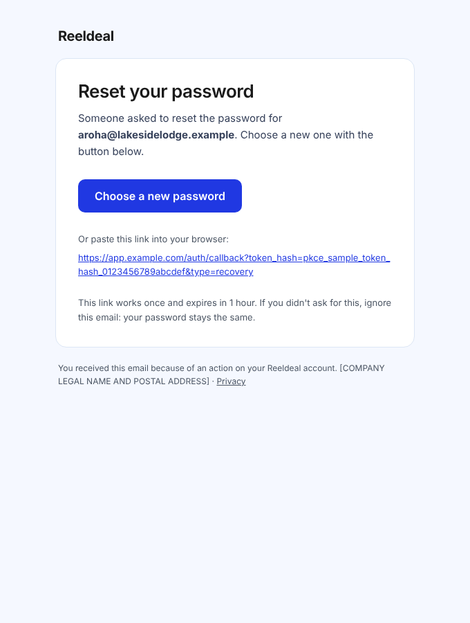
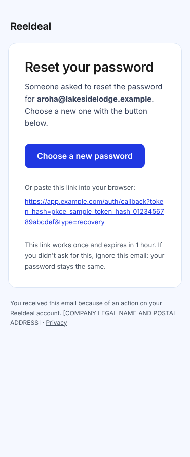
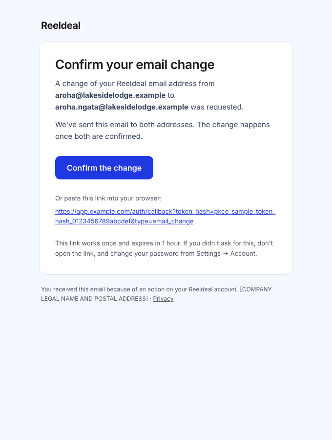
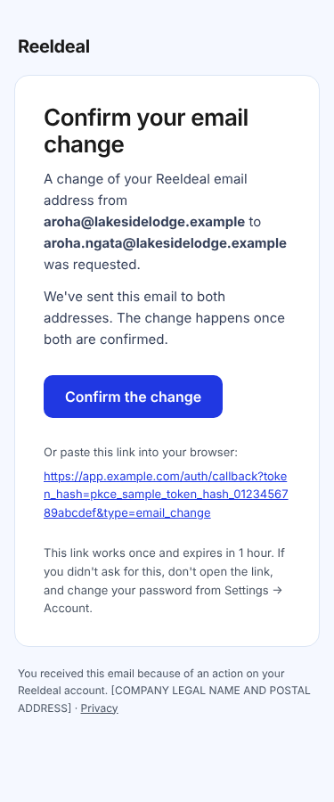
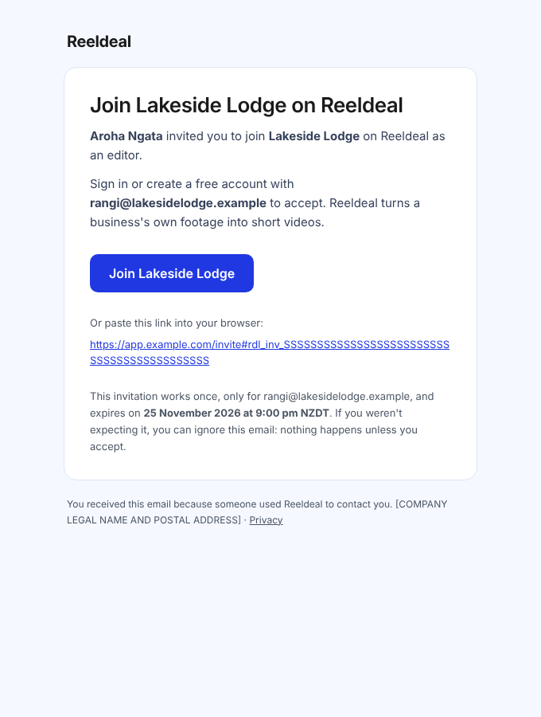
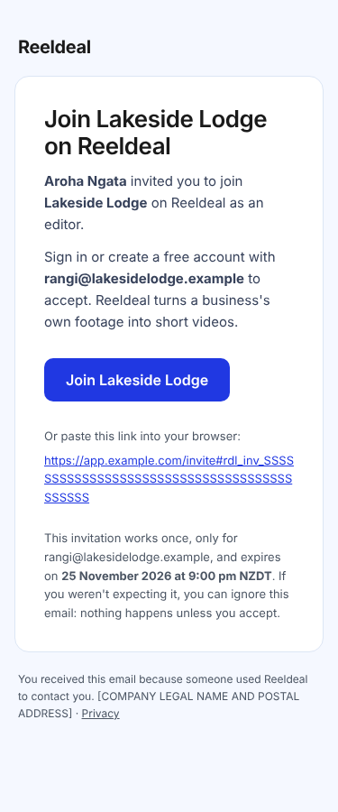
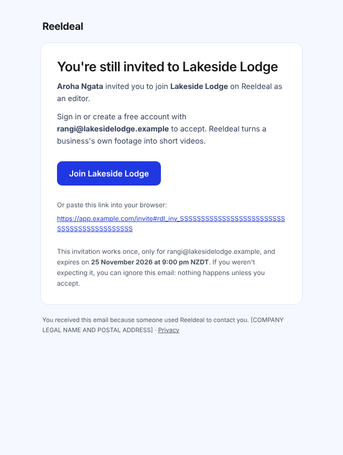
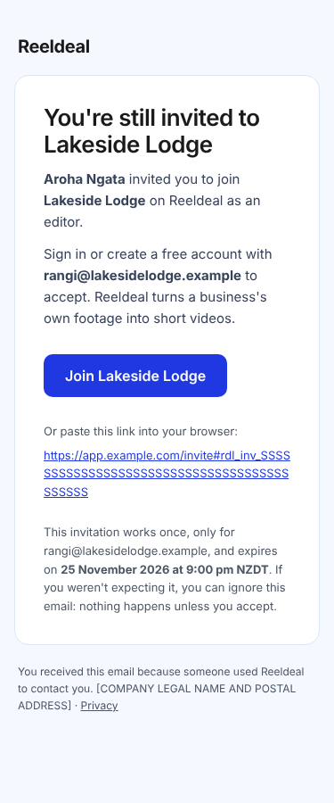

# Email template review pack

Generated by `npm run review:emails` (sample data, nothing sent). Every email is plain inline-styled
HTML tables (Gmail, Outlook and Apple Mail safe), 520px wide at most, one column on phones (checked:
no sideways scrolling at 375px). Each has a text version (Resend) or Supabase's automatic one.

| Email | Subject | Sent by | Link expiry | Desktop (680px) | Phone (375px) |
|---|---|---|---|---|---|
| [Confirm signup](confirmation.html) | Confirm your Reeldeal email | Supabase Auth (Resend SMTP) | 1 hour (Email OTP expiration 3600 s) |  |  |
| [Reset password](recovery.html) | Reset your Reeldeal password | Supabase Auth (Resend SMTP) | 1 hour |  |  |
| [Change email address](email-change.html) | Confirm your new Reeldeal email | Supabase Auth (Resend SMTP), to both addresses | 1 hour |  |  |
| [Workspace invitation](invitation.html) | Aroha Ngata invited you to Lakeside Lodge on Reeldeal | The app (Resend API) | 7 days, exact date and time in the email |  |  |
| [Invitation reminder ("Resend" on a pending invitation: a new link)](invitation-reminder.html) | Reminder: join Lakeside Lodge on Reeldeal | The app (Resend API) | 7 days from the new link |  |  |

## Review checklist

- [ ] Wording and tone (Reeldeal voice: plain, warm, short)
- [ ] `[COMPANY LEGAL NAME AND POSTAL ADDRESS]` in every footer: owner copy still needed
- [ ] Sender: `no-reply@mail.<domain>` for account emails; invitations from `EMAIL_FROM` (e.g. `Reeldeal <team@mail.<domain>>`)
- [ ] Links: account emails use `{{ .SiteURL }}/auth/callback?token_hash=…` (any device); invitations put the token after `#`, so it never reaches a server log
- [ ] Expiry stated in each email matches the settings (Email OTP expiry 3600 s; invitations 7 days)
- [ ] Nothing sensitive in subjects or preheaders (no tokens; names only)

## Safety properties (tested: `src/server/email/email.test.ts`)

- Every value is HTML-escaped (a workspace called `<script>` renders as text).
- One send per invitation: `Idempotency-Key: invitation:<id>`, so a retried action can't email twice.
- Nothing about a message is logged: no address, link, body or API key; only the outcome.
- Without `RESEND_API_KEY` and `EMAIL_FROM` nothing is sent and the admin copies the link instead.
